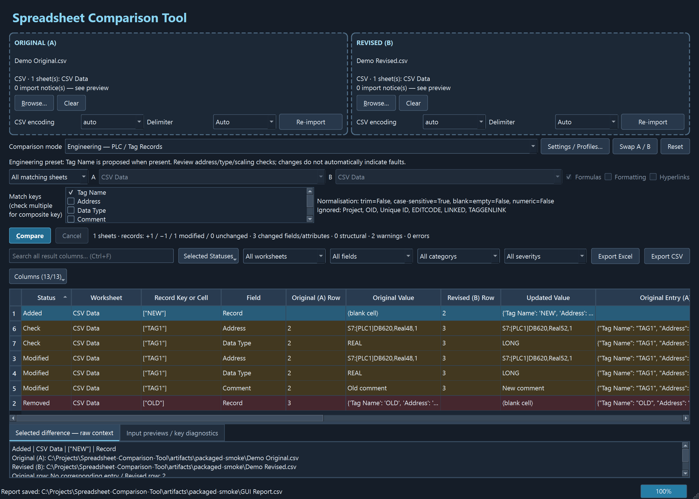

# Validation results — 27 October 2026

## Environment and result

- Windows 10 x64, build 19045.
- Python 3.13.9, PySide6 6.10.2, openpyxl 3.1.5, pytest 8.4.2, PyInstaller 6.16.0. Exact environment: `requirements-lock.txt`.
- **64 tests passed; 0 failed; 0 skipped.** Latest suite runtime approximately 9 seconds on this machine.
- A real, windowed, one-folder Windows executable was created and launched successfully on this Windows machine. Its automated GUI self-test completed with exit code 0 and `passed: true`.
- Executable: `dist\SpreadsheetCompare\SpreadsheetCompare.exe`.

## Test coverage

`tests/test_imports.py`: BOM/UTF-8 and Windows cp1252 fallback, comma/semicolon/tab detection, quoted commas/quotes/newlines, leading-zero IDs, complex PLC addresses, empty/whitespace fidelity, inert CSV formula text, malformed CSV, encoding errors, nonexistent/unsupported/corrupt inputs, sparse Excel, merged cells, blank sheets, XLSM reading and cancellation.

`tests/test_comparison.py`: equality and reordered records, added/removed/modified counts, multiple changed fields per record, duplicate-key quarantine on both sides, blank keys, composite keys, field mapping, sheet/column structure, explicit manual pairing, no inferred worksheet rename, formulas, stable array formula expressions, optional font/number-format/hyperlink comparisons, cell counts without attribute double counting, mixed CSV/Excel with explicit pairing, conservative numeric/blank/string semantics, configurable header rows, invalid keys/headers, metadata exclusion for CSV, blank/merged worksheets, cancellation and duplicate sheet-pair prevention.

The scale test compares **12,000 unique records in reverse order** and asserts zero changes within a 10-second bound. Actual complete suite runtime is approximately 3 seconds; this is a representative scale check, not a guarantee for all workbook sizes.

`tests/test_engineering.py`: address/type/device/scaling categories, configurable administrative ignores, modified-tag versus field counts, device/cluster address namespaces, literal exceptions, disabling checks and optional missing-scaling checks.

`tests/test_exports_profiles.py`: workbook sheets/counts, frozen headers/autofilters, UTF-8 BOM CSV, formula-trigger payloads including leading whitespace, explicit XLSX string cell types and absent active hyperlinks, checksums unchanged, source-overwrite rejection, atomic cancellation, long-text chunks, malformed-profile recovery and profile round-trip.

`tests/test_gui_smoke.py`: actual Qt drag/drop events, Browse path via the file-dialog return, mode/key controls, worker completion, preview diagnostics, result rendering/context, filtering, full export despite a GUI filter, Excel/CSV export via workers, proposed engineering keys, swapping additions/removals, invalid drops, settings mapping, event-loop heartbeats during a 12,000-record import, mixed Excel/CSV worksheet pairing, manually clearing a proposed key and worker cancellation.

## Packaged executable verification

`tests/test_status_filter.py`: multiple statuses can be checked in the same open menu; clearing every status hides all rows; status selections combine with Search and field filters; a new comparison resets the selection to all available statuses.

The dark UI was visually checked in the comparison window, Settings, Columns menu and Qt file chooser. Result row backgrounds use dark green/red/amber with light foreground text; the rebuilt portable executable runs the same all-mode import/comparison/export smoke check described below. Exported Excel report colours remain suited to documents.

`tests/test_columns_menu.py`: checkbox clicks immediately hide/show view columns while the menu stays open; data columns remain intact; Show all restores the view; column choices persist locally and at least one column remains visible.

`tests/test_source_entries.py`: reordered records retain distinct A/B source row numbers, original/updated values and complete entry payloads in the GUI model and both exports; cell differences retain full corresponding row values; added entries leave the missing side empty.

`scripts/build_windows.ps1` runs pytest, builds the application and **launches that executable** with `--self-test`. The final packaged check imported synthetic CSV and Excel files, used all three GUI modes, compared formula expressions, selected explicit CSV/Excel worksheet pairs, exported both report formats, reopened the Excel report and checked unchanged hashes for all four input files. No user preferences were read or changed by this diagnostic mode.

Synthetic fixture expectations confirmed:

| Workflow | Added | Removed | Modified | Field/attribute differences |
| --- | ---: | ---: | ---: | ---: |
| General record matching, CSV | 1 | 1 | 1 | 4 |
| General cell comparison, CSV | 0 | 0 | 9 | 9 |
| General cell comparison, Excel | 0 | 0 | 10 | 10 |
| General record matching, CSV/Excel | 1 | 1 | 1 | 4 |
| Engineering record matching | 1 | 1 | 1 | 3 |

The engineering result excludes the `Project` change by profile. Cell comparison sees row-address differences because the synthetic revision deliberately reorders records. These are **synthetic validation counts**, not results for the unavailable ST045 production files.

Evidence generated by the build: `artifacts\packaged-smoke\self-test.json`, `Application.png`, `GUI Report.xlsx`, `GUI Report.csv`, and four synthetic input files. A screenshot copy is included below. The build isolates DLL discovery from unrelated tools on PATH, preventing an incompatible Poppler ICU DLL from entering the application bundle.



## Reproduce

From the project root:

```powershell
.\scripts\setup_windows.ps1
.\.venv\Scripts\python.exe -m pytest -q
.\scripts\build_windows.ps1
```

The packaged check is Windows-native automation, not a claim of manual Explorer dragging or manual Microsoft Excel review. Clean-machine installation without Python, Windows 11, Python 3.12 and the unavailable production ST045 exports remain unverified. See [known limitations](LIMITATIONS.md).
